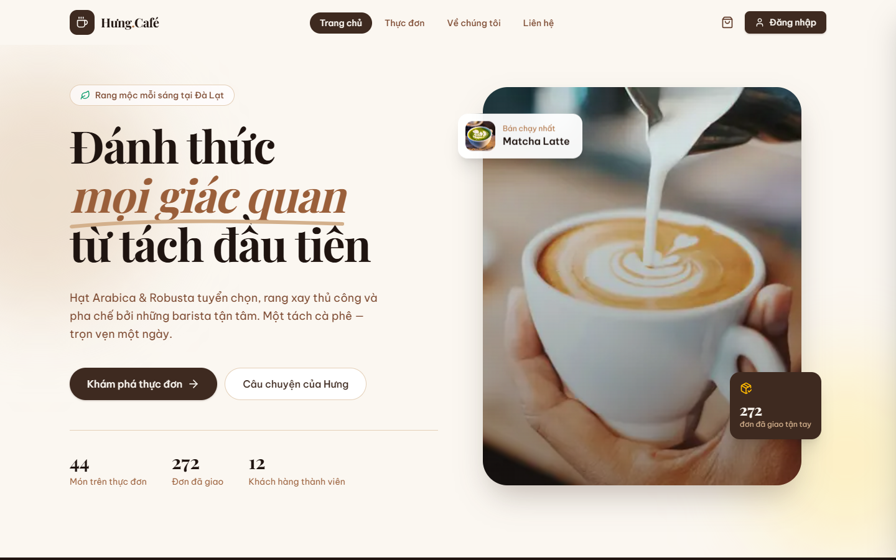
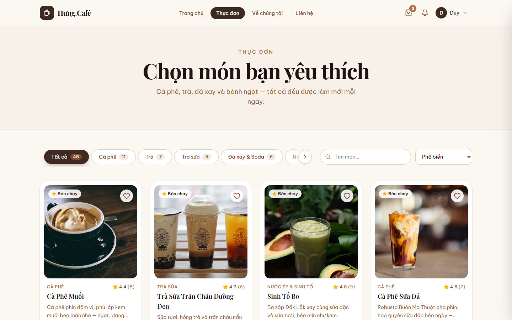
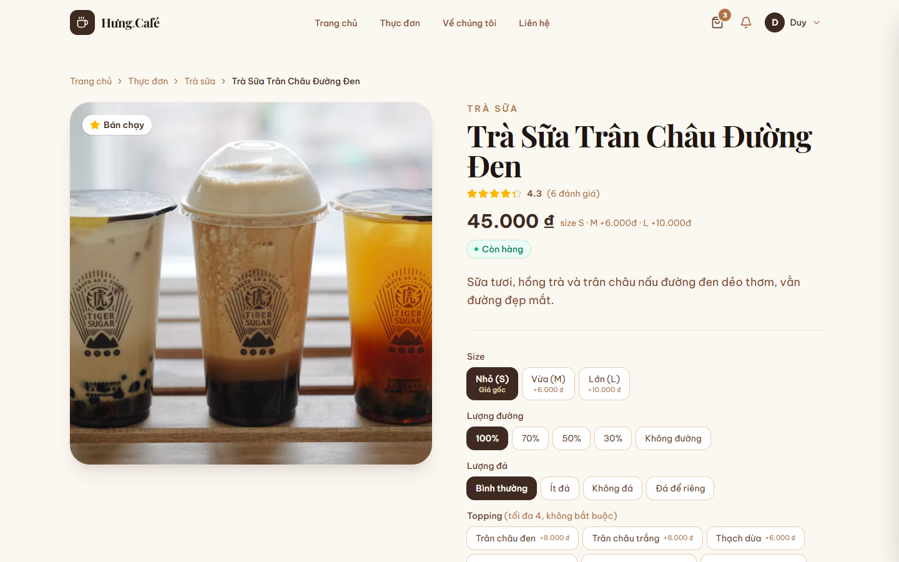
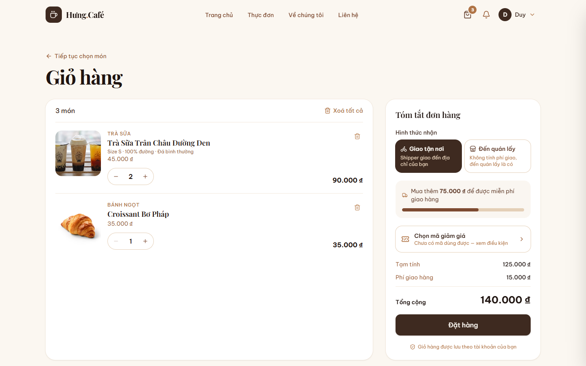
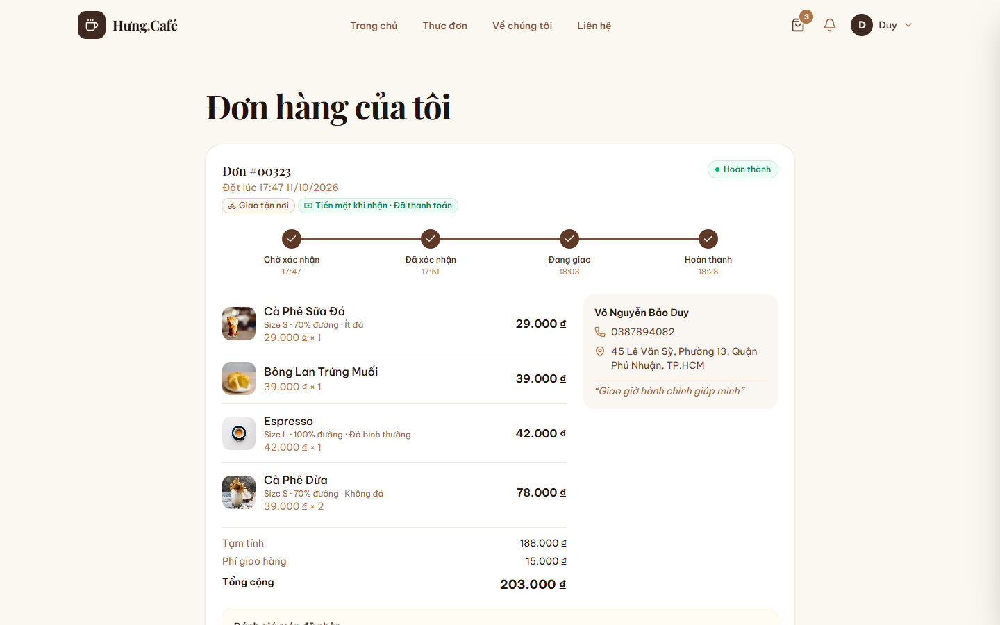
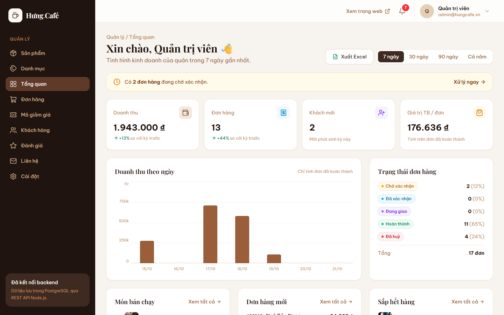
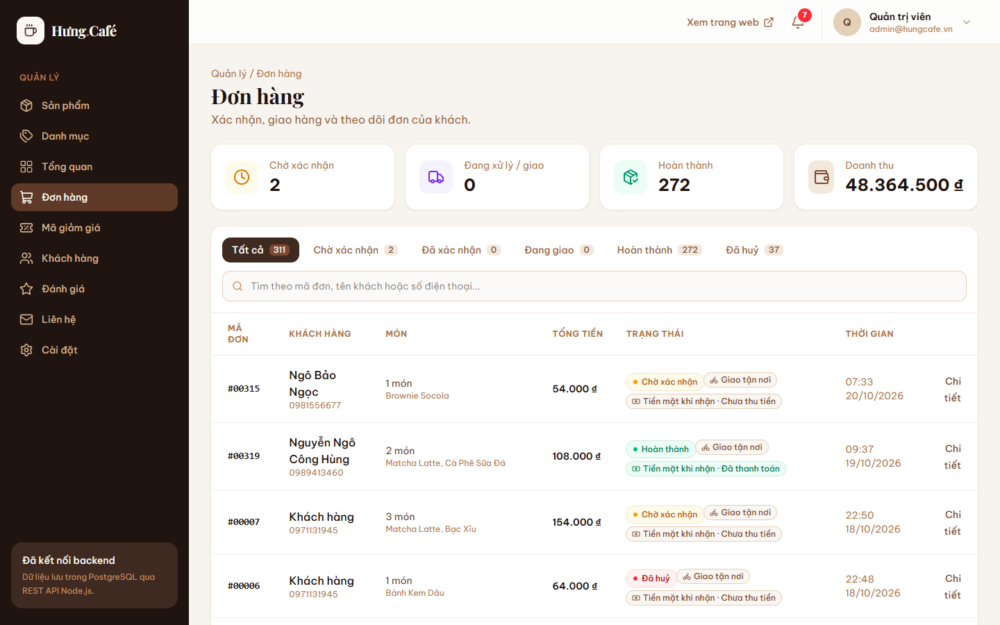
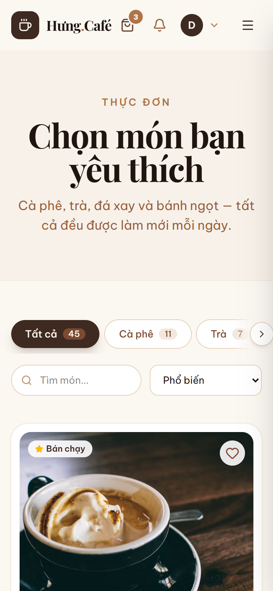
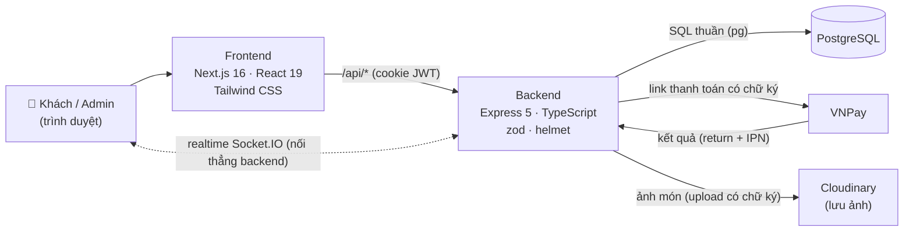

<div align="center">

# ☕ Hưng Café

**Website đặt đồ uống cho quán cà phê.** Khách xem thực đơn, chọn size / đường / đá / topping, đặt hàng, thanh toán VNPay và theo dõi đơn từng bước. Chủ quán quản lý món, đơn hàng, khách hàng, mã giảm giá và xem thống kê doanh thu.

[](https://github.com/Kaito1412Hung/hung-cafe/actions/workflows/ci.yml)


### 🌐 [Xem web thật: hung-cafe.vercel.app](https://hung-cafe.vercel.app) · 📖 [Tài liệu API](https://hung-cafe.vercel.app/api/docs)



</div>

## 👀 Xem thử

| | |
| --- | --- |
| **Web** | https://hung-cafe.vercel.app |
| **Tài khoản khách demo** | `khach@hungcafe.vn` · mật khẩu `demo123456` (đã có sẵn lịch sử 7 đơn hàng) |
| **Tài liệu API (Swagger)** | https://hung-cafe.vercel.app/api/docs |

- Muốn thử đầy đủ (đổi mật khẩu, sửa hồ sơ…) thì bấm **Đăng ký** tạo tài khoản riêng. Tài khoản demo dùng chung nên bị khoá các thao tác đó để người sau vẫn vào được.
- Dùng máy chủ miễn phí nên **lần đầu mở có thể chậm 30–60 giây** (máy chủ đang "ngủ"), sau đó nhanh bình thường.
- Web thật hiện chỉ bật **thanh toán tiền mặt khi nhận**; VNPay chạy ở môi trường thử trên máy.
- Trang quản trị chỉ dành cho chủ quán. Xem trước giao diện admin ở mục **📸 Hình ảnh** bên dưới.

<!-- Quay xong GIF demo thì bỏ dấu chú thích ở dòng dưới:

-->

## ✨ Điểm nổi bật

- **Thanh toán VNPay an toàn:** ký và kiểm tra chữ ký **HMAC-SHA512**. Sửa số tiền trên link là bị từ chối. Cùng một giao dịch báo về 2 lần cũng chỉ ghi nhận 1 lần (khoá dòng trong transaction). Đơn quá **15 phút** chưa trả thì tự huỷ và trả lại kho. Khách trả muộn sau khi đơn đã huỷ thì đơn chuyển sang "cần hoàn tiền".
- **Không bán quá số lượng:** đặt hàng chạy trong **transaction** có khoá dòng (`FOR UPDATE`). Tồn kho và lượt dùng mã giảm giá luôn đúng, kể cả khi nhiều người đặt cùng lúc.
- **Đơn hàng lưu "bản chụp":** tên và giá món / topping được lưu lại lúc đặt, nên sau này quán đổi giá thì đơn cũ vẫn đúng.
- **Bảo mật:** mật khẩu băm bcrypt, JWT trong **cookie httpOnly**, thu hồi phiên ("đăng xuất mọi thiết bị"), chống dò mật khẩu, giới hạn tần suất gửi form, helmet, kiểm tra mọi dữ liệu gửi lên bằng **zod**.
- **SQL thuần, không ORM:** tự viết truy vấn bằng `pg`. Schema nâng cấp được nhiều lần (`IF NOT EXISTS`, khối `DO $$`) mà không mất dữ liệu cũ.
- **Giờ Việt Nam ở mọi nơi:** lưu `TIMESTAMPTZ`, tính và hiển thị theo `Asia/Ho_Chi_Minh` (đơn hàng, thống kê, file Excel), máy chủ đặt ở múi giờ nào cũng đúng.
- **Ảnh món lưu trên Cloudinary:** upload có chữ ký (secret không rời máy chủ), tự chọn định dạng nhẹ nhất (`f_auto,q_auto`, ảnh nhẹ hơn khoảng 3 lần). Máy chủ không giữ file nên deploy lại không mất ảnh. Chưa điền mã thì tự lưu ổ cứng như cũ.
- **Tài liệu API bằng Swagger** (`/api/docs`, chuẩn OpenAPI 3.1): 78 API chia 11 nhóm, bấm thử ngay trên trình duyệt. Phần "gửi lên gì" sinh tự động từ schema **zod** đang dùng để kiểm tra dữ liệu, nên tài liệu không bao giờ lệch với code.
- **Realtime bằng Socket.IO:** khách đặt đơn → trang admin hiện đơn mới ngay + tiếng "ting"; admin đổi trạng thái → thanh tiến trình của khách tự nhảy bước, không cần F5. Thay cho cách cũ "cứ 30 giây hỏi server một lần" (polling). Mỗi người một **phòng** riêng (khách A không bao giờ nhận tin đơn của khách B); vì Vercel không chuyển tiếp WebSocket nên trình duyệt nối thẳng Render bằng **vé JWT 2 phút**; tin chỉ gửi **sau khi transaction COMMIT** (lỗi giữa chừng không có "đơn mới ảo"); mất mạng tự nối lại và tải lại dữ liệu.
- **Test tự động + CI/CD:** 71 bài test bằng **Vitest + Supertest**: chữ ký VNPay (sửa số tiền là bị từ chối), tính tiền / giảm giá, giờ mở cửa theo giờ VN, đặt hàng trừ đúng tồn kho, **2 người cùng mua phần cuối cùng thì chỉ 1 người mua được**, huỷ đơn trả kho, phân quyền, mã giảm giá hết lượt. Test API chạy trên database riêng tạo mới mỗi lần. **GitHub Actions** tự chạy typecheck + test + build mỗi lần push; Render / Vercel tự deploy.
- **Deploy thật trên cloud:** Vercel (giao diện) → Render (API) → Neon (PostgreSQL) + Cloudinary (ảnh). Đã đo chuỗi proxy Vercel → Cloudflare → Render để lấy đúng IP người dùng cho phần chống spam (`TRUST_PROXY`). Tài khoản demo dùng chung được bảo vệ: không đổi được mật khẩu / hồ sơ / xoá tài khoản, gõ sai mật khẩu không làm khoá người khác.
- **Thống kê cho chủ quán:** doanh thu theo 7 / 30 / 90 ngày hoặc cả năm theo tháng, món bán chạy, xuất báo cáo **Excel**.

## 📸 Hình ảnh

| Thực đơn | Chi tiết món (size, đường, đá, topping) |
| :---: | :---: |
|  |  |
| **Giỏ hàng** | **Đơn của tôi: giờ của từng bước** |
|  |  |
| **Admin: tổng quan & thống kê** | **Admin: quản lý đơn hàng** |
|  |  |

<details>
<summary>📱 Giao diện trên điện thoại</summary>
<br>

</details>

## 🏗️ Kiến trúc



**Khi chạy thật (deploy):**

| Phần | Chạy ở | Ghi chú |
| --- | --- | --- |
| Giao diện Next.js | **Vercel** | Chuyển tiếp `/api/*` sang backend, tự build lại khi push GitHub |
| API Express | **Render** (Singapore) | Gói miễn phí, tự deploy lại khi push GitHub |
| PostgreSQL | **Neon** (Singapore) | Kết nối có SSL |
| Ảnh món | **Cloudinary** | |

Backend chia theo module: `routes → controller → service (SQL) → schema (zod)`. Luồng chi tiết (đặt hàng, VNPay, thống kê) xem ở [docs/kien-truc.md](docs/kien-truc.md).

## 🧩 Chức năng

**Khách hàng**
- Thực đơn 45 món / 7 danh mục, tìm món gõ không dấu (`ca phe` vẫn ra "Cà Phê")
- Mỗi món có lựa chọn riêng: size, mức đường, nóng hay đá, lượng đá, topping (tối đa 4), ghi chú
- Giỏ hàng, đặt hàng, chọn mã giảm giá từ danh sách (hoặc nhập mã bí mật)
- Thanh toán **tiền mặt khi nhận** hoặc **VNPay** (kiểm tra chữ ký, tự huỷ đơn quá 15 phút chưa trả, hoàn tiền khi huỷ đơn đã trả)
- Chọn **giao tận nơi** hoặc **đến quán lấy** (không tính phí giao), **hẹn giờ nhận** trong hôm nay / ngày mai
- Theo dõi đơn: giờ của từng bước (đặt → xác nhận → giao → hoàn thành) + "Dự kiến giao lúc …"
- Huỷ đơn kèm lý do, mua lại đơn cũ, thông báo khi đơn đổi trạng thái
- Đánh giá món đã mua, món yêu thích, hồ sơ cá nhân + ảnh đại diện, đổi mật khẩu, đăng xuất mọi thiết bị

**Quản trị (admin)**
- Tổng quan: doanh thu, số đơn, món bán chạy theo 7 / 30 / 90 ngày hoặc cả năm (biểu đồ theo tháng), xuất báo cáo Excel
- Quản lý món (ảnh, tồn kho, lựa chọn của từng món), danh mục, topping
- Quản lý đơn hàng (chia trang, lọc, tìm kiếm, in hoá đơn, ghi nhận hoàn tiền), khách hàng, mã giảm giá
- Quản lý đánh giá: xem tất cả đánh giá, lọc theo số sao / món, tìm không dấu, xoá đánh giá không phù hợp
- Hộp thư liên hệ, danh sách nhận tin, thông báo đơn mới, cài đặt cửa hàng (giờ mở cửa, phí giao)

## 🚀 Chạy trên máy

Cần cài: **Node.js 20+** và **PostgreSQL**.

```bash
# 1. Backend
cd backend
npm install
cp .env.example .env      # sửa DATABASE_URL (mật khẩu postgres) và JWT_SECRET
npm run db:setup          # tạo database, bảng và dữ liệu mẫu
npm run dev               # http://localhost:4000  (tài liệu API: /api/docs)

# 2. Frontend (mở terminal khác)
cd frontend
npm install
cp .env.example .env.local
npm run dev               # http://localhost:3000
```

Tài khoản mẫu (admin + khách) lấy theo các biến `SEED_*` trong `backend/.env`.

**Chạy test tự động** (cần PostgreSQL đang chạy, test tự tạo database riêng `hung_cafe_test`, không đụng dữ liệu thật):

```bash
cd backend
npm test                  # 71 bài test, khoảng 25 giây
```

Muốn lưu ảnh món trên cloud: đăng ký miễn phí tại [cloudinary.com](https://cloudinary.com), điền `CLOUDINARY_CLOUD_NAME`, `CLOUDINARY_API_KEY`, `CLOUDINARY_API_SECRET` vào `backend/.env`. Không điền thì ảnh lưu trong thư mục `backend/uploads/`.

Muốn bật VNPay: đăng ký tài khoản sandbox tại [sandbox.vnpayment.vn](https://sandbox.vnpayment.vn/devreg/), điền `VNP_TMN_CODE` và `VNP_HASH_SECRET` vào `backend/.env`. Không điền thì web chỉ có thanh toán tiền mặt.

## 📁 Cấu trúc

```
backend/    REST API — Express + PostgreSQL (SQL thuần)   → xem backend/README.md (danh sách API)
frontend/   Giao diện — Next.js App Router               → xem frontend/README.md
docs/       Tài liệu: cấu trúc database, luồng hoạt động chính, hình ảnh
```

## 📚 Tài liệu

- 📖 **Tài liệu API tương tác (Swagger):** https://hung-cafe.vercel.app/api/docs (hoặc chạy backend rồi mở http://localhost:4000/api/docs)
- [Danh sách API](backend/README.md#api)
- [Cấu trúc database](docs/database.md)
- [Các phần nối với nhau thế nào](docs/kien-truc.md)

## 🗺️ Dự định phát triển

- [x] Deploy lên mạng + tài khoản demo để xem thử
- [x] Tài liệu API bằng Swagger (`/api/docs`)
- [x] Test tự động cho backend (Vitest + Supertest)
- [ ] Test giao diện tự động (Playwright)
- [x] Realtime bằng Socket.IO: admin thấy đơn mới ngay, khách thấy đơn đổi trạng thái không cần tải lại
- [x] CI/CD bằng GitHub Actions (test + build mỗi lần push, Render / Vercel tự deploy)
- [ ] App mobile (React Native)
